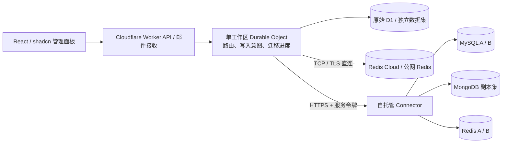

# 数据源切换、自动同步和服务器迁移

支持 D1、MySQL 8、MongoDB 副本集、Redis 7 的主数据存储。同类型可以添加多个实例：MySQL A → MySQL B、Redis A → Redis B；也可以跨类型切换。每次切换都会自动复制、追平变更、校验并更换活动数据集。

## 运行结构



Connector 模式的原生数据库账号存在你自己的连接服务器上，面板配置 HTTPS 地址、数据源 ID 和服务令牌。Redis 也支持 Workers TCP/TLS 直连：完整 URI 使用 `STORAGE_ENCRYPTION_KEY` 加密保存在协调器，接口仅返回去掉凭据的地址。一个连接服务可以连接多个数据库，也可以在每台新服务器分别部署一个连接服务。数据库类型并不充当实例 ID。

## Redis 直接连接与免费实例

在「添加数据源」选择 Redis → Redis 直接连接，填写名称、`redis://用户名:密码@服务器:端口/0` 或 `rediss://...`、独立数据命名空间和用途。`rediss` 使用 TLS；`redis` 是服务商提供的普通 TCP。连接地址不返回给浏览器，更新凭据时留空保持原值；更换服务器或数据库需添加新数据源。

- **数据副本**：适用于免费 Redis 或无法检查持久化的托管实例。点击「同步副本」复制、追平并校验当前数据，完成后继续使用原主库。它是完成时刻的副本，后续修改需要再次同步；不把内存副本当作持久备份。
- **可切换主库**：连接时检查 `appendonly yes`、`appendfsync always` 和 `maxmemory-policy noeviction`，并继续使用版本/所有者校验和单 Hash 原子写入。检查不通过时明确拒绝添加为主库，可改选副本用途。托管服务不开放这些检查时也不能宣称其持久化已通过验证。

每次同步创建独立 generation，不覆盖已有键。副本也受容量、网络和服务商回收策略影响；Redis 重启丢失副本后可从仍在运行的主库重新同步。当前不提供持续副本订阅、定时副本计划或旧副本自动回收。

连接服务使用应用专用的表/集合/命名空间存储结构化记录；不会把 SQL 翻译成 MongoDB 命令，也不会迁移目标服务器上的其他业务库。MySQL 使用 `mailhub_meta_v1` / `mailhub_rows_v1`，MongoDB 使用同名集合，Redis 使用带数据集标识的 单个 Hash（包含版本和删除标记）。

## 升级现有 Worker

1. 备份原始 D1，执行 `0004_storage.sql` 在内的全部数据库迁移。
2. 在现有 `wrangler.toml` 中加入下面的绑定与迁移，保留原来的数据库 ID、域名和 Secrets。若已有同名迁移标记，使用新的唯一标记。

```toml
[[durable_objects.bindings]]
name = "STORAGE"
class_name = "StorageCoordinator"

[[migrations]]
tag = "storage-v1"
new_sqlite_classes = ["StorageCoordinator"]
```

3. 生成并保存至少 32 位随机 `STORAGE_ENCRYPTION_KEY`，通过 `pnpm exec wrangler secret put STORAGE_ENCRYPTION_KEY` 配置。这个密钥加密远程连接令牌，丢失后无法解密已保存的连接。不要直接轮换这个 Secret；当前版本尚未实现密钥重新加密操作。
4. 使用 `pnpm deploy` 构建前端并部署。未配置 STORAGE 的旧安装可继续使用 D1，但无法开启热切换；新的部署模板和初始化脚本已包含该绑定。

数据库管理接口只接受管理员浏览器会话，普通自动化 API Key 不可更改数据源。系统在协调器内保留登录验证所需的最小设置镜像；原库故障时，已有登录会话仍可查看数据源状态。没有活动会话且主库离线时，仍需先恢复连接才能重新登录。

## 部署连接服务

要求 Node.js 22 或 Docker。复制 `connector/sources.example.json` 为 `secrets/storage-sources.json`，只保留你实际需要的实例，修改其中连接地址。给连接服务使用专用数据库和账号。

```bash
mkdir -p secrets
chmod 700 secrets
cp connector/sources.example.json secrets/storage-sources.json
# 编辑数据库连接配置；不要把真实配置提交到 Git。
node -e "require('fs').writeFileSync('secrets/connector-token',require('crypto').randomBytes(32).toString('base64url'),{mode:0o600})"
# 使用与秘密文件所有者相同的 UID/GID 运行容器。
chmod 600 secrets/storage-sources.json secrets/connector-token
MAILHUB_UID=$(id -u) MAILHUB_GID=$(id -g) docker compose -f compose.connector.yml up -d --build
```

Compose 只在 `127.0.0.1:8080` 监听，用 Caddy/Nginx 或 Cloudflare Tunnel 提供 HTTPS。例如 `https://storage.example.com` 转发到本机 8080。不要直接把数据库端口开放给浏览器。生产接口只允许 HTTPS，禁止 URL 内嵌密码、查询参数以及重定向。

非容器方式：设置 `MAILHUB_SOURCES_FILE` 指向 JSON 文件，`CONNECTOR_TOKEN_FILE` 指向令牌文件，然后运行 `pnpm connector:dev`。正式进程可用 `pnpm build:connector` 构建后由 systemd 托管 `node dist/connector.mjs`。`LISTEN_HOST` 默认 `0.0.0.0`，本机反向代理可设置为 `127.0.0.1`。`PORT` 默认 8080。

- MySQL：InnoDB，账号需要对专用库建表、读写权限。远程连接建议配置 `tls: true`，验证服务器证书。密码中的特殊字符应 URL 编码。
- MongoDB：要求副本集或分片集群，使用多数派确认的事务。单机 standalone 会被拒绝，防止把非原子写入伪装成成功。
- Redis：要求 `appendonly yes`、`appendfsync always`、`maxmemory-policy noeviction`。检查失败会拒绝将其作为主存储。需要允许 `CONFIG GET` 以核对这些设置。持久化文件必须放在持久卷；本地测试 Compose 的 tmpfs 不用于生产。
- Redis 查询通过有界扫描实现，单表十万条（包含删除标记）以上会明确报错；大量邮件建议选 MySQL/MongoDB。MySQL JSON 查询也不是为百万级邮件索引设计，需要依据规模增加业务索引。

连接服务的 `/healthz` 只表示进程存活；面板「测试连接」实际检查数据库。一个配置源在启动时连接失败会让服务启动失败，避免隐藏的无效数据源。不要将整个服务器磁盘或其他业务数据库挂载进容器。

## 在面板操作

进入「数据源 → 添加数据源」：填名称、数据库类型、HTTPS 地址、`sources` 文件中的 `id`、连接服务令牌。连接成功后才能保存。令牌加密保存且不会返回给浏览器。已有数据源的「连接设置」可以修改名称或更新服务令牌；更新会验证数据库连接与数据集身份，地址变更需要添加新数据源后迁移。

选择目标的「同步并切换」后：

1. 创建新的隔离数据集；不覆盖目标的已有数据集。
2. 分页复制账号、分组、标签、关联关系、CF 邮件、平台台账、临时邮箱、域名、系统设置、OAuth 状态和登录限流记录。
3. 重放复制期间的增量变更，包括新增、修改和删除。保留主键以及已删除记录占用过的 ID 序列。
4. 暂停新的写入，逐页比较规范化记录的 SHA-256 摘要，比较最终版本与 ID 序列。读取继续可用；写入返回 `503 SWITCH_IN_PROGRESS` 和 `Retry-After`，调用方应稍后重试。邮件存储失败会抛错，让 Cloudflare 按其投递策略重试。
5. 只有校验一致才持久化活动数据源指针，恢复写入。

同步由 Durable Object alarm 驱动，关闭页面后继续。可重试的失败退避重试，同一轮累计五次失败后暂停。暂停或校验失败时原库继续服务，可点击「继续同步」或取消。最终校验失败会回到追平阶段后重新校验。

源写入先持久化意图，再提交数据库。每批有预期版本与摘要，提交响应丢失时会识别已完成的批次；进程重启后先恢复未确认写入，防止跳过记录或重复分配 ID。目标已提交多批变更而本地检查点尚未保存时，会核对目标摘要与持久化日志，恢复正确的重放位置。单批变更最大 8 MiB，单次事务最多变更两千条；大清理任务分批执行。

切换不会删除旧数据集。**切回旧实例也会先同步最新数据**，不提供直接读取过期副本的“强制切回”。源服务器已经永久不可读时，不能保证把它尚未同步的写入恢复出来；需要原库备份或原服务恢复。

## 换服务器

新服务器部署并验证数据库与 Connector → 在面板添加新的数据源 → 同步并切换 → 验证账号、邮件和自动化 API → 再决定是否下线原服务器。同一类型的两台服务器使用同一套流程。不要提前关闭源服务器。

迁移的是 MailHub 数据。Worker Secrets、Cloudflare DNS/Email Routing、微软应用注册、TLS 证书和容器配置不在数据库中，不会凭空复制。Worker 和唯一协调器继续运行在原 Cloudflare 工作区。跨 Cloudflare 账号或更换协调器的全站迁移需要独立交接；当前版本不自动搬迁控制面。

只有经由应用的写入会进入变更日志。禁止在同步期间通过数据库客户端直接修改 MailHub 记录。外部写入不会触发原生 CDC；如最终校验发现差异会停止切换。目标端 owner fencing 与版本 CAS 防止另一个独立控制器同时接管，但复制同一个协调器身份的双活部署不受支持。

## 备份与容量

源库与目标库使用的是新数据集，必须有足够空间保存全量内容。同步期间协调器保存增量日志，完成/取消后分批清理。旧数据集不会自动清理，当前只保留最近 20 个历史指针显示；请使用数据库备份和运维流程管理长期保留，不要删除当前活动 generation。

生产备份需要包含：当前主数据源、协调器持久化状态、`STORAGE_ENCRYPTION_KEY`、其他 Worker Secrets 和连接服务器配置。账号 JSON 导出不等于全站备份；迁移副本也不能代替独立备份。当前没有面板的一键控制面备份/恢复功能。

## 验证

```bash
pnpm typecheck
pnpm test
# 以下命令仅创建隔离、本机回环端口、虚构凭据的测试实例：
docker compose -p mailhub-storage-test -f compose.storage-test.yml up -d --wait
pnpm test:storage
docker compose -p mailhub-storage-test -f compose.storage-test.yml down
```

`test:storage` 使用真实 MySQL 8.4、MongoDB 8 副本集、Redis 7 两个独立实例，经真实 HTTP Connector 完成 D1 → MySQL → MongoDB → Redis A → Redis B → D1。其他单元测试覆盖复制失败恢复、进程重建、提交响应丢失、并发增删改、校验失败拒绝切换和密钥保护。
