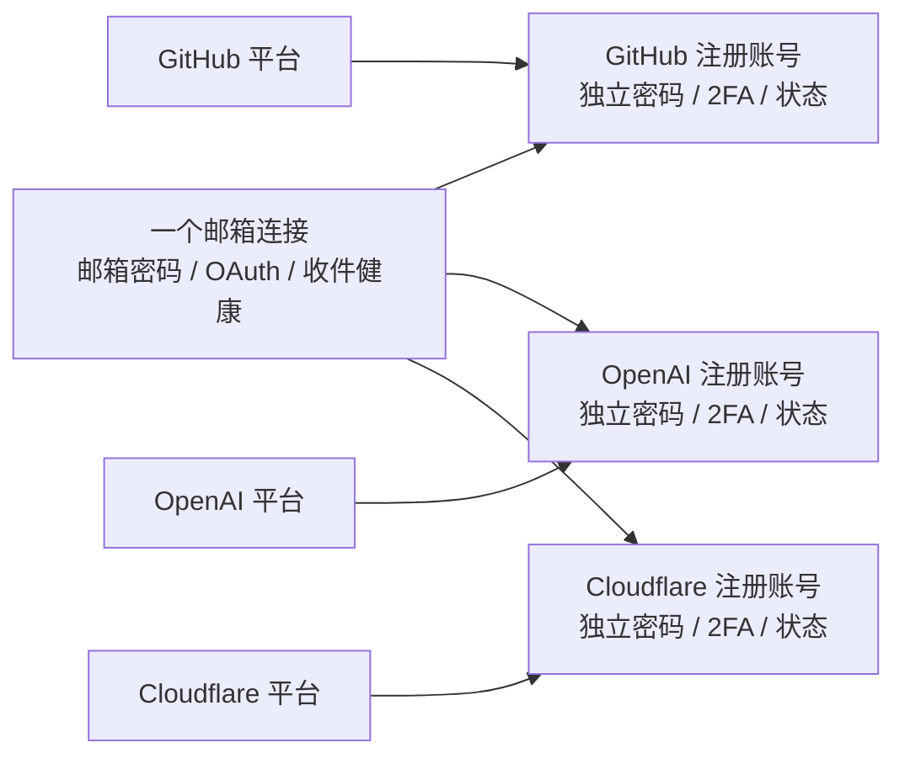

# 一个邮箱注册多个平台：需求调研与实施基线

调研日期：2026-11-17。代码基线：`77e36cac3834d81e8e0a3cd06c0117b1ff362e0f`。

实现与本地验收已记录在 [共享邮箱验证记录](VERIFICATION-SHARED-REGISTRATIONS.md)，当前操作说明见 [平台账号](PLATFORM-ACCOUNTS.md)。下文保留调研基线，不据此推断所有建议都已完成或已经生产发布。

本文是需求调研及后续实现的验收基线，不表示下面的新增功能已经上线。本轮分别调查后端关系、前端操作、产品边界与公开参考，主代理负责交叉核对、兼容性和优先级。证据包括静态阅读及子代理在禁用外部请求条件下进行的内存路由复现；没有使用真实用户凭据，没有向第三方平台注册账号或发送邮件。本轮未启动应用服务、运行全量测试或进行浏览器验收，未验证下述竞态在生产是否发生过。

## 1. 要解决的用户任务

用户有一个 Outlook 邮箱，同时注册 GitHub、OpenAI、Cloudflare；每个平台有自己的密码、用户名、2FA 和使用状态。用户需要从邮箱看到全部平台注册，从平台找到正确邮箱，继续登记其他平台，并准确查收当前操作的验证码。



一个邮箱连接可以服务多个平台注册账号。一个平台也可以包含多个邮箱、多个注册账号。同一邮箱在同一平台存在多个登录身份、租户或独立站点时，仍允许分别登记；单个登录账号加入多个组织，则优先记录组织成员关系，避免虚增登录账号数。

邮箱密码、平台注册密码和平台 2FA 分别保存；不通过复制邮箱凭据来创建平台注册。SSO 或邮件链接登录可以没有平台密码。邮箱连接成功也不能证明 GitHub 等目标平台登录正常。

## 2. 已有能力和本次范围

当前已有独立平台目录、按平台汇总、同邮箱多条台账、邮件详情关联台账、来源健康状态、文本交换、统一取码，以及 Mail.tm / Mail.gw 接入。见 [平台账号](PLATFORM-ACCOUNTS.md)、[外部邮箱](EXTERNAL-MAILBOXES.md)、[账号交换](ACCOUNT-TRANSFER.md)。

本次的目标是补齐共享邮箱的完整管理流程和正确性，不重复建设已经存在的平台管理、Outlook 授权修复或密码回显。历史 [创新建议书](PRODUCT-INNOVATION-PROPOSAL.md) 中的“现状”只作为历史背景，不能当作当前缺陷清单。

第一阶段聚焦共享关系、查码、导入和删除的正确性，以及邮箱视角的管理入口；第二阶段扩展别名、SSO、生命周期和可确认的注册发现。浏览器插件、自动登录外部平台、大规模后台邮箱扫描不作为本轮的前置条件。

### 已确认的现状与缺口

| 结论                                            | 证据和实际影响                                                                                                                                                                                                                                    | 类型                                              |
| ----------------------------------------------- | ------------------------------------------------------------------------------------------------------------------------------------------------------------------------------------------------------------------------------------------------- | ------------------------------------------------- |
| 现有关联列表已经能显示同邮箱多条台账，且有分页  | [RelatedVaultAccounts](../web/features/readers.tsx#L150) 精确查询完整地址，每页 100 条并按总数分页；不能描述成“只展示前几条”或完全没有关联功能。                                                                                                  | 已有能力                                          |
| 普通新增不会将邮箱密码填入其他平台              | [Outlook 登记入口](../web/pages/outlook.tsx#L337)、[Provider 登记入口](../web/pages/providers.tsx#L333) 只预填邮箱和来源；新平台密码独立填写。                                                                                                    | 已有能力                                          |
| 普通台账更新已经保留未提交的字段                | [PUT 合并已有记录](../src/routes/vault.ts#L580) 后校验；省略密码和 2FA 不会清空，显式空字符串才清空。后文局部更新需求主要针对导入，不能误报成所有编辑都会丢凭据。                                                                                 | 已有能力                                          |
| 稳定存在任意 CF 台账绑定时，邮箱删除会被拒绝    | [删除前置校验](../src/routes/mailboxes.ts#L278) 检查全部同址 CF 台账；正常删除代表账号会重新选代表，清理还会检查其它保护。单值代表字段不代表其它台账关系被删除。                                                                                  | 已有保护                                          |
| `vault_id` 定位目标邮箱，不会自动筛出该平台来信 | [目标解析](../src/automation.ts#L125)、[台账取码](../src/routes/vault.ts#L611) 只使用地址、来源和调用方筛选；[CF 查询](../src/codes.ts#L78) 返回最近匹配邮件，因此另一平台更新的验证码也可能被取到。                                              | P1 需求缺口，代码确认                             |
| 验证码历史可能被误解为属于某个平台              | [CF 来信](../src/email-handler.ts#L146) 把验证码写到同址 CF 来源的全部台账；[手动取码](../src/codes.ts#L133) 把结果写入指定台账。覆盖的是 `last_code/last_code_at`，不是账号凭据或原邮件。                                                        | P1 语义及归属问题，代码确认                       |
| 邮箱停用删除存在引用检查与提交的并发间隙        | [删除路由](../src/routes/mailboxes.ts#L271) 在事务前判断无引用，提交时没有重查；中途新增绑定完成后，仍会过期该邮箱并删除未置顶邮件，删除条件未排除刚受保护的邮件。新台账保留而邮件可被删除。                                                      | P1 正确性缺陷，子代理受控内存复现，主代理复核代码 |
| 导入去重忽略邮箱来源                            | [vaultIdentity](../src/vault-import.ts#L61) 只含小写平台名、邮箱、用户名；[同批去重](../src/vault-import.ts#L184) 最后一条覆盖前一条；[库内冲突处理](../src/routes/vault.ts#L291) 默认跳过，选更新则可改写来源。不同来源身份可能被当成同一条。    | P1 身份兼容缺口，代码确认                         |
| 导入更新是完整替换，缺省凭据会清空              | [导入校验](../src/vault-import.ts#L50) 将缺省密码 / 2FA 设空，[更新路径](../src/routes/vault.ts#L306) 完整写回。现有界面和交换文档已提示覆盖风险，仍需要增加保留未提供字段的导入方式及字段差异预览。                                              | P1 需求缺口，现有已声明行为，非普通编辑缺陷       |
| 来源身份在关联列表中不够明显                    | [关联行](../web/features/readers.tsx#L201) 按地址聚合且未展示来源连接；这确认了辨识不足，不能由此断言实际收件 API 混用了来源。                                                                                                                    | P1 交互缺口                                       |
| 停用外部邮箱后，来源页查看全部关联不便          | [Provider 操作](../web/pages/providers.tsx#L300) 停用时禁用收件；[关联列表](../web/pages/providers.tsx#L741) 位于收件弹窗内。关系管理应独立于是否可以收件。                                                                                       | P1 交互缺口                                       |
| 单个代表字段的手动选择与搜索不稳定              | [link-vault](../src/routes/mailboxes.ts#L238) 可选代表，后续 [protectMailbox](../src/routes/vault.ts#L51) 会重新选择最小 ID；[邮箱搜索](../src/routes/mailboxes.ts#L54) 仅匹配代表平台。完整关系仍在。                                            | P2 查询及代表语义问题                             |
| 跨页面返回上下文及组合验收不足                  | [导航类型](../web/lib/context.tsx#L13) 主要携带页面和查询词；[阅读器跳转](../web/features/readers.tsx#L498) 会先关闭阅读器。[现有 E2E](../tests/e2e/workspace.spec.ts#L94) 的批量例子是一个平台的两个不同邮箱，尚不能证明一邮箱多平台的整条链路。 | P2 体验与测试覆盖缺口，静态检查                   |

本轮未确认 P0 生产事故。后文 P0 指扩展实现时应优先满足的正确性要求。尤其不能把“代表字段被重选”误报成“其它平台注册被删除”，也不能把未覆盖的 E2E 场景直接当成已经复现的故障。

## 3. 必须明确的对象和统计

| 对象 / 指标        | 定义与约束                                                                                        |
| ------------------ | ------------------------------------------------------------------------------------------------- |
| 平台               | 独立目录对象，允许零账号；邮箱来源不是平台分组的唯一依据。                                        |
| 平台注册账号       | 一条台账记录，有稳定 ID；保存该平台的登录资料、登记状态和主邮箱关系。                             |
| 邮箱地址           | 用于注册和投递的地址字符串。沿用现有大小写规范，保留原显示值；不擅自去掉 `+tag`、点号或替换域名。 |
| 邮箱连接身份       | 具体来源中的可收件身份，由来源和稳定来源记录标识；相同地址在不同来源出现时仍是不同连接。          |
| 已登记平台数       | 独立平台数，包含空平台；不是邮箱服务商数。                                                        |
| 平台注册账号数     | 台账记录数；不是 Outlook / 外部邮箱连接数。                                                       |
| 邮箱地址数         | 台账或邮箱池中不同地址的去重数量，界面明确覆盖范围。                                              |
| 异常邮箱与影响范围 | 一个邮箱连接失效计一个异常连接，并另显示它影响的 N 条平台注册；不自动把这些平台都改为封禁。       |

邮箱视角可以把相同地址放在同一组中帮助发现关系，但必须展示各来源连接并分别操作；聚合展示不能导致凭据、状态或验证码跨来源混用。尚未接入的地址显示“未接入”，不能伪造可收件连接。

## 4. 需求与优先级

P0 表示扩展前必须保证的数据及取码正确性；P1 表示直接完成核心用户任务；P2 表示在前两项基础上的扩展，不表示当前生产发生了事故。

| 编号      | 优先级 | 需求                       | 验收结果                                                                                                                            |
| --------- | ------ | -------------------------- | ----------------------------------------------------------------------------------------------------------------------------------- |
| REL-01    | P0     | 共享关系完整               | 新增第二、第三个平台后，所有关系可查询；编辑、解除或删除其中一条只影响该条。                                                        |
| REL-02    | P0     | 清理与停用按全部关联判断   | 只要仍有受保护的平台注册关联，临时邮箱和邮件就遵守现有保留保护；不能只检查一个“主关联”。                                            |
| IMP-01    | P0     | 导入冲突可见且不丢凭据     | 重复判定纳入来源及账号身份；提供跳过、仅更新给定字段、显式完整替换；未提供的密码或 2FA 在局部更新时保留。                           |
| VER-01    | P0     | 平台取码不静默串号         | 按目标账号、来源、时间和已配置规则查询；匹配不充分或结果歧义时给候选，不能把其他平台的最新邮件当成功。                              |
| UX-01     | P1     | 平台视角和邮箱视角互通     | 平台内能查看“该邮箱还登记了哪些平台”；邮箱详情列出全部登记，并可继续登记。                                                          |
| UX-02     | P1     | 一次选择邮箱，多次登记平台 | 邮箱和来源预填，可依次登记多个平台；每条使用独立平台凭据，失败保留输入。                                                            |
| UX-03     | P1     | 可操作的关系与计数         | 支持搜索、筛选、分页、准确总数及批量整理；不能仅用少量标签替代完整关系列表。                                                        |
| ID-01     | P1     | 同平台多身份与登录方式     | 同邮箱同平台可登记明确不同的账号身份；单个账号可记录密码、SSO、邮件链接等多种登录方式，未知方式单独表示，避免把“未存密码”等同异常。 |
| HEALTH-01 | P1     | 健康和状态分层             | 邮箱连接异常、平台手工登记状态、平台登录核验分别表述；共享邮箱一次修复后所有关联视图刷新。                                          |
| API-01    | P1     | API 可精确定位             | 提供邮箱身份与关联账号查询；保留 `vault_id` 精确目标和旧调用兼容；多目标必须明确返回歧义。                                          |
| LIFE-01   | P2     | 生命周期与影响提示         | 可记注册日期、用途、最后人工核验、到期和恢复信息；停用或换邮箱前列出影响。                                                          |
| ALIAS-01  | P2     | 显式别名和投递关系         | 区分注册使用的别名与实际收件连接，保留精确收件人；未经确认不自动合并地址。                                                          |
| DISC-01   | P2     | 可确认的平台注册发现       | 来信提供“可能已注册”的建议，附证据、时间、忽略选项；确认后才创建正式登记。                                                          |

## 5. 建议交互

### 平台视角

保留现有平台卡片和平台详情抽屉。在账号行增加可点击的邮箱及“还关联 N 个平台”入口，展示共享关系。打开邮箱详情时保留原平台的搜索、页码、选择和滚动位置。

从邮箱进入“登记其他平台”时，预填邮箱地址与来源，只填写新平台资料。已有同平台账号时展示身份摘要供核对，允许用户明确创建不同身份，不强制覆盖。详情和编辑继续遵循当前密码回显、隐藏、复制的交互；关系汇总本身无需加载密码或令牌。

从现有登记解除收件连接时保留其登录邮箱文本和平台凭据，明确显示“未接入”。“更换登录邮箱”“解除收件连接”“删除平台注册”使用不同操作与确认；本地解除不能宣称第三方平台已换邮箱或注销。

### 邮箱视角

Outlook、自建邮箱、外部邮箱使用一致的“邮箱详情”入口：顶部显示地址、来源、连接状态及影响范围；主体提供“平台注册”“收件”“连接资料”页签。平台登记表按平台分组，可切换紧凑列表，展示用户名、登录方式、登记状态、取码、编辑及解除关系操作。

概览区明确显示“3 个平台 / 4 条注册记录”，完整列表采用分页，不把首屏标签数当总量。对数量较多的账号展示“查看全部”，支持按平台和身份搜索。从任一邮箱继续登记时不默认把它的平台填成 Outlook。

### 抽屉与弹窗

延续现有 shadcn Sheet、Dialog、Tabs、Table、AlertDialog 和 CredentialField，不引入第二套组件体系。邮箱详情优先复用同一个抽屉的上下文切换；编辑、取码使用顶层弹窗。每次 Escape 只关闭顶层，关闭后恢复触发焦点，失败保留数据，列表刷新不卸载正在操作的菜单。

桌面、手机竖屏、手机横屏都检查长邮箱、长平台名、空列表、异常状态、加载、保存失败和深色模式。沿用项目已有的固定标题、滚动正文和底部操作区约定。

## 6. 账号和邮箱关系的实现约束

以下是设计建议，不是当前数据库结构。

1. 保留现有 `platform_vault.id` 作为平台注册身份，不因邮箱重复而合并记录。
2. 建立稳定的邮箱身份引用，能区分 `outlook`、`cf_domain`、`mailtm`、`mailgw` 及未托管来源。来源原始凭据仍在各自账号表维护一次，不复制到平台记录。
3. 一期可为台账增加可空的主邮箱身份引用，保留原 `account_email`、`email_source` 兼容字段。区分已关联、待解析和用户主动解除三种状态；主动解除后不得在下一次按地址查询时自动重新关联。没有确切来源记录时标记未解析；不选择第一个同地址连接作为默认。
4. 关系列表、数量、删除影响和保留保护必须采用同一权威关系；旧的单值关联只能作为兼容投影，不能继续决定“这个邮箱是否仍被使用”。
5. 同平台重复提示应考虑来源、登录方式、用户名或身份标识、站点或租户。没有足够信息时要求用户选择冲突处理；不以 `(平台, 邮箱)` 建立全局唯一约束。
6. 别名及恢复邮箱多对多属于后续扩展。若引入角色关系表，应明确主邮箱、恢复邮箱等用途；不能把一次 SSO 登录加入多个组织误建为多个密码账号。
7. 换主邮箱须在事务中更新所选平台注册的关系及相关索引，保留原邮箱和其它平台注册；记录影响摘要，处理并发版本冲突。

## 7. 取码与自动化

当前 `vault_id` 能指定一条台账；它本身不等于已经验证邮件属于该平台。平台模式需要平台可维护的发件人、主题、站点和验证码规则，明确显示本次采用的条件。`since` 默认从当前等待动作开始，历史结果保留原时间，不冒充新验证码。

不能直接从平台官网域名推导全部发件人：SSO 邮件可能由 Google / Microsoft 发出，多个平台也可能共用发信服务。规则必须可查看、编辑和停用；可提供模板，但不能把模板匹配包装成外部平台身份认证。

同邮箱两个平台同时等待时，各自保留目标和起始时间。候选结果包含来源、收件人、发件人、主题、时间、邮件 ID 和匹配理由；无法确定唯一结果时由用户选择。跨平台不能共享一个无上下文的“最新验证码”缓存。复制不标已读，不自动访问验证链接。

重发验证码后，旧邮件可能比新邮件晚到；时间先后并不能保证轮次正确。后续若需要同平台同时执行多个注册任务，增加独立请求 ID、去重、重发轮次和领取语义，再承诺避免重复消费；单靠“最新一封”和相同时间范围无法保证两个并发任务各拿到不同验证码。复制或领取与“目标平台已接受验证码”分开记录。

收到欢迎邮件、工作区邀请、密码重置或疑似封禁通知都只能作为线索。候选应带证据来源及观察时间，允许忽略；用户确认或可验证的目标平台结果才能确认相应事实。现有 `active` 保留人工登记的含义，不升级为已验证注册或已核验登录。

## 8. API、权限和数据兼容

以下路径只是建议契约，当前尚未新增：

| 建议接口 / 扩展                                   | 用途                                                                                        |
| ------------------------------------------------- | ------------------------------------------------------------------------------------------- |
| `GET /api/mailbox-identities`                     | 统一邮箱身份列表，按地址、来源、状态和关联数量筛选、分页。                                  |
| `GET /api/mailbox-identities/{id}/registrations`  | 查询全部关联，返回平台数、注册数及分页信息，不带凭据。                                      |
| `POST /api/mailbox-identities/{id}/registrations` | 复用明确邮箱身份登记新平台，邮箱密码不进入平台密码字段。                                    |
| `GET /api/mailbox-identities/{id}/impact`         | 删除、停用、迁移前查看受影响的台账和保护状态。                                              |
| 台账关系更新和导入预览扩展                        | 沿用普通 PUT 省略字段保留的能力；导入新增只更新给定字段、身份冲突选择、明确保留与替换语义。 |
| 现有验证接口扩展                                  | 显式平台匹配模式、候选结果、匹配理由和歧义错误；保留邮箱级查收模式。                        |

新路由进入现有 API 授权白名单，新增字段同步 OpenAPI、AI 文档及 TypeScript / Python SDK。`email` 继续允许用于邮箱级查收，`vault_id` 用于精确台账目标；不能静默改变旧接口含义。

当前资源限制支持 `emails`、`platforms`；当邮箱被多个平台共用时，“可访问某个平台关联的邮箱”不等于邮件内容被安全地按平台隔离。新界面必须解释授权范围；发件人或关键词过滤只帮助业务匹配，不能作为强隔离保证。严格隔离任务应使用独立的邮箱身份，并在服务端按该身份授权。新增关系查询不能让受限密钥枚举未获准的平台或读取凭据。

新关系和身份字段必须同时接入 D1、MySQL、MongoDB、Redis、统一写入协调器、迁移重放和备份校验。当前业务备份为 schema 12；扩展时冻结 schema 12 后再引入新版本，继续验证原 schema 10/11/12 的哈希后确定性转换，不能手工只改版本号。

旧数据回填只在来源和地址唯一匹配时建立已确认引用。重复、缺失或跨来源冲突进入待处理清单，原账号 ID、凭据、登记状态、平台目录和备注全部保留。重复执行回填不得生成重复关系。数据源切换和恢复后按稳定 ID 核对完整关系及凭据，不只比较总条数。关系记录同样消耗现有备份的 1,000 行 / 1 MiB 配额，不能声称容量不变。

## 9. 核心验收场景

| 场景                                             | 应得到的结果                                                                   |
| ------------------------------------------------ | ------------------------------------------------------------------------------ |
| 一个 Outlook 邮箱登记 GitHub、OpenAI、Cloudflare | 1 个邮箱连接、3 条平台注册；两种视角都能查看全部关系。                         |
| 从邮箱连续登记第二、第三个平台                   | 邮箱身份始终明确；平台密码各不相同；邮箱凭据不被更改。                         |
| 同邮箱同平台两个确实独立的身份                   | 可区分并保存，导出再导入不被误去重；一个登录账号的两个组织也有适当表示。       |
| 同地址同时存在于两个来源                         | 展示独立连接；请求必须明确来源或台账目标；健康和取码不混用。                   |
| 删除三个平台注册中的一条                         | 剩余两条、邮箱凭据、邮件及其保留保护继续存在。                                 |
| 删除最后一条 CF 台账                             | 清空代表关系后仍按既有永久邮箱和保留策略处理，不隐式销毁已有邮箱或邮件。       |
| 停用请求已判断无绑定，提交前恰好新增绑定         | 删除事务内重新核验并拒绝停用；新台账、邮箱状态和受保护邮件全部保留。           |
| 解除或更换某条台账的邮箱                         | 只改变所选关系，其它共享账号保持原关联；冲突时整笔取消。                       |
| 共享邮箱需要重新授权                             | 显示 1 个异常连接及 N 条影响；目标平台手工状态不被改成封禁。                   |
| 邮箱修复完成                                     | 保留原平台密码 / 2FA；连接待检查或已检查状态按实际结果更新到全部关联视图。     |
| 先来 GitHub 码，后来 Cloudflare 码               | GitHub 平台模式不会把较新的 Cloudflare 码当作确定成功。                        |
| 收到 Cloudflare 来信                             | 原邮件保留；未经规则确认，不把该码广播保存为 GitHub 等其它平台的已匹配验证码。 |
| 两个任务同时在同邮箱等待                         | 目标、条件和起始时间独立；歧义时返回候选，不覆盖对方结果。                     |
| 平台使用 SSO 或没有匹配规则                      | 明确显示登录方式和查收范围；不以猜测规则冒充平台精确查码。                     |
| 不完整文本导入选择局部更新                       | 未提供密码和 2FA 时保留原值；预览能看到真实更新范围。                          |
| 100 条以上关联、分页和快速搜索                   | 总量准确，所有关系可翻页找到；返回后恢复筛选位置；刷新不打断菜单。             |
| 平台 A 关联邮箱 X、Y，平台 B 也关联 X            | 显示 2 个平台、2 个邮箱地址、3 条注册；再登记 X 的一个独立身份只增加注册数。   |
| 从一封营销邮件发现陌生平台                       | 只生成待确认建议，不进入正式注册统计，不自动改状态。                           |
| 同邮箱关联一个获准平台和一个未获准平台           | 受限 API Key 不能通过关系摘要枚举未获准记录；授权范围不被关键词过滤夸大。      |
| D1 → Redis → MySQL → MongoDB 与备份往返          | ID、各来源邮箱身份、平台注册、凭据和保护语义一致，旧备份没有被篡改。           |
| 手机竖屏 / 横屏，抽屉内编辑或查码                | 标题及底部按钮可达，长文本无横向溢出；只关闭顶层，失败保留输入。               |

## 10. 实施顺序

1. 先修邮箱停用的并发引用检查，再明确共享关系的权威来源、导入身份判定及更新语义，补上清理 / 删除 / 并发回归场景。
2. 加入平台匹配的取码模式和歧义结果，验证两个平台共用邮箱的相邻来信及并发等待。
3. 增加邮箱详情与完整关联列表、继续登记入口、准确计数和上下文返回，沿用现有 shadcn 组件。
4. 统一稳定邮箱身份及 API，完成多数据库和旧备份兼容验证后再发布。
5. 在可追溯的关系基础上扩展别名、登录方式细化、生命周期和可确认的注册发现；独立评估后台扫描的成本和服务商限制。

每个阶段都以具体用户流程和数据库最终状态验收，不能只验收表单能打开、接口返回 200 或列表数字增加。

## 11. 外部经验与取舍

以下公开资料由产品研究子代理核对，访问日期均为 2026-11-17。它们用于确认场景和借鉴交互，不用于推断本仓库已具备相同能力。

| 来源                                                                                                                                                                                                                                                       | 核对事实                                                                                                                                | 对本项目的取舍                                                                                             |
| ---------------------------------------------------------------------------------------------------------------------------------------------------------------------------------------------------------------------------------------------------------- | --------------------------------------------------------------------------------------------------------------------------------------- | ---------------------------------------------------------------------------------------------------------- |
| [cf-outlook-email 固定快照](https://github.com/roseforyou/cf-outlook-email/tree/c3fd54978732b4abb6f6f35bd2ffad499c70685d)，以及该版本 [API 示例](https://github.com/roseforyou/cf-outlook-email/blob/c3fd54978732b4abb6f6f35bd2ffad499c70685d/docs/API.md) | 该版本以 Outlook 邮箱账号、分组、标签和邮件查询为主；取码示例从近期邮件选取数字。所查公开模型未覆盖平台注册身份、工作区或验证任务归属。 | 继续借鉴邮箱管理与修复流程；一邮箱多平台需要本项目独立补充关系和归属判断，不能直接沿用“第一组数字即结果”。 |
| [Microsoft：添加或移除 Outlook.com alias](https://support.microsoft.com/en-us/office/add-or-remove-an-email-alias-in-outlook-com-459b1989-356d-40fa-a689-8f285b13f1f2)                                                                                     | alias 是现有 Microsoft 账号的另一个用户名。                                                                                             | 区分别名、收件连接与平台注册身份；不按地址字符串自动创建或合并独立账号。                                   |
| [1Password：记录登录提供商](https://support.1password.com/sign-in-with-provider/)                                                                                                                                                                          | 网站 Login item 可以记录并关联登录提供商。                                                                                              | 记录“该平台注册通过哪个上游身份登录”，并允许多种登录方式；不把邮箱 OAuth 连接等同于平台 SSO。              |
| [Slack：更改邮箱地址](https://slack.com/help/articles/207262907-Change-your-email-address)                                                                                                                                                                 | 同一邮箱可用于多个工作区，但工作区账号分别存在，改邮箱需逐工作区处理，SSO 也可能限制修改。                                              | 增加工作区消歧；跨平台换邮箱保存逐项进度，不以一次本地批量编辑声称外部变更全部完成。                       |

“更换数据库 / 服务器”与“更换外部平台上的注册邮箱”是两种操作。前者迁移本系统数据关系，后者需要分别在第三方完成并确认；本地改完地址不能代表远端账号也已更改。

## 12. 研究验证记录

| 调研方向                      | 完成情况 | 证据方式                                                                                                                                                                                   |
| ----------------------------- | -------- | ------------------------------------------------------------------------------------------------------------------------------------------------------------------------------------------ |
| 后端、取码、导入与删除        | 已完成   | 子代理代码检查；主代理复核关键代码；真实路由及存储计划器配合内存适配器复现并发交错。                                                                                                       |
| 前端入口、来源辨识和 E2E 覆盖 | 已完成   | 子代理检查现有界面代码及用例；主代理复核分页、来源操作等关键位置。未进行新的视觉验收。                                                                                                     |
| 产品边界和外部经验            | 已完成   | 子代理核对四个公开来源；结论与本仓库已有文档区分记录。                                                                                                                                     |
| 权限、凭据与数据兼容          | 已完成   | 主代理核对 [资源授权](../src/api-keys.ts#L378)、[凭据保护](../src/storage/secure.ts#L15)、[备份表清单](../src/storage/coordinator.ts#L20) 和 [旧备份校验](../src/routes/backups.ts#L745)。 |

并发删邮的子代理复现通过 `node` 的标准输入运行临时脚本，未保留落盘脚本；它在“无绑定”的前置查询返回后暂停删除，再完成新增绑定和保护，最后恢复删除。报告的关键输出如下：

```json
{
  "scenario": "forced_interleaving_mailbox_delete_after_unbound_precheck_deletes_newly_protected_mail",
  "passed": true,
  "retained_vaults": 1,
  "retained_mails": 0
}
```

这里的 `passed` 表示缺陷复现成功，不是回归测试通过。子代理报告外部请求数和文件写入数均为 0。该证据不替代 D1 / Coordinator 及真实远程存储的回归测试；实施修复时须把同样的强制交错保存为可重复运行的正式用例。
